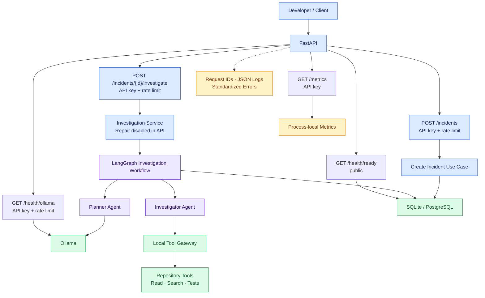
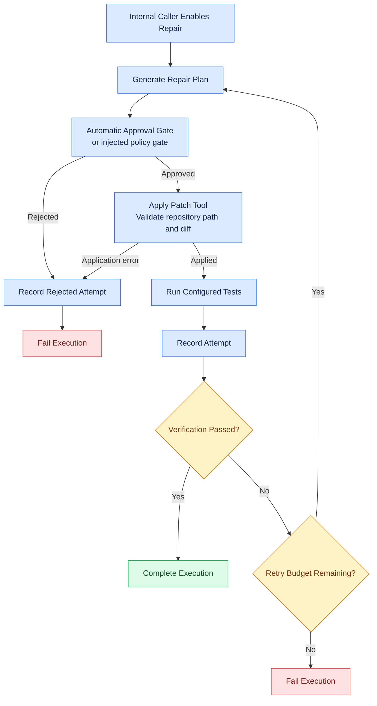

# 🛡️ Sentinel

### Autonomous Multi-Agent Engineering Ops Copilot

**Turn engineering incidents into structured investigations, auditable executions, and verifiable repair attempts.**

Sentinel is a Python-based engineering incident assistant built with FastAPI, LangGraph, and Ollama. It investigates incidents through controlled repository tools, records execution outcomes, and includes an optional internal workflow for constrained patching, test verification, and retries.

> **Portfolio scope:** The public API supports incident creation and investigation initiation. Autonomous repair is demonstrated through a separate deterministic test fixture—not through a public patch API or a claim of general LLM accuracy.

---

## 🧭 Architecture at a Glance



### Core components

| Component | Responsibility |
|---|---|
| **FastAPI** | Incident creation, investigation initiation, health checks, and authenticated metrics |
| **LangGraph** | Coordinates investigation execution and the optional internal repair/verification loop |
| **Planner agent** | Uses Ollama to generate investigation plans |
| **Investigator agent** | Maps investigation steps to registered tools |
| **Tool gateway & policy** | Controls repository operations and validates patch paths and context |
| **Persistence adapters** | Store incidents, executions, tool audits, and repair history |
| **Operations layer** | Request IDs, structured logs, standardized errors, rate limiting, and HTTP metrics |

---

## ⚙️ How Sentinel Works

### 1. Incident investigation


The public API starts an investigation and returns incident/execution status. It does **not** expose investigation findings or patch application.

### 2. Optional internal repair workflow



This workflow is an **internal capability**, not a public repair endpoint.

**Safety boundaries**

- Repair is disabled by default in the application factory.
- The default internal approval gate is automatic—not human-in-the-loop approval.
- Absolute paths and paths escaping the configured repository are rejected.
- `.git`, `.env`, `.env.local`, and `.env.production` are protected.
- Unified-diff context must match before a file is written.
- Verification failures can trigger retries within the configured policy.
- Sentinel does not create Git branches, commits, pull requests, or deployments as part of repair.

---

## ✨ Key Capabilities

<details>
<summary><strong>Incident investigation</strong></summary>

- Authenticated incident creation and investigation initiation.
- LLM-assisted investigation planning through Ollama.
- Registered repository tools for controlled investigation.
- Execution lifecycle tracking and persistence.

</details>

<details>
<summary><strong>Constrained repair and verification</strong></summary>

- Internal repair planning and unified-diff parsing.
- Repository path and patch-context validation.
- Approval-gate integration.
- Test-based verification and bounded retry handling.
- Persisted repair-attempt outcomes.

These capabilities are exercised through internal workflows and deterministic tests; they are not exposed as public patch or approval endpoints.

</details>

<details>
<summary><strong>API operations and observability</strong></summary>

- API-key authentication and endpoint rate limiting.
- Request IDs in response headers and standardized error bodies.
- Structured JSON request logs.
- Sanitized unexpected API errors.
- Authenticated Prometheus metrics.
- Database readiness checks.

Metrics are process-local and reset when the process restarts. They are not automatically aggregated across multiple instances.

</details>

---

## 🌐 Public API

The deployed FastAPI application exposes an **investigation API**, not a patch API.

| Method | Endpoint | Purpose |
|---|---|---|
| `POST` | `/incidents` | Create an incident from a title and description |
| `POST` | `/incidents/{incident_id}/investigate` | Start an investigation and return incident/execution status |
| `GET` | `/health` | Public shallow health response |
| `GET` | `/health/ready` | Check database connectivity |
| `GET` | `/health/ollama` | Authenticated provider health check |
| `GET` | `/metrics` | API-key-protected Prometheus metrics |

The incident routes and Ollama health endpoint require `X-API-Key` and are rate-limited.

Standardized API errors include a stable error code and request ID. The request ID is returned in both the JSON body and the `X-Request-ID` header.

**Interactive API documentation:** [OpenAPI / Swagger UI](https://sentinel-api-6jrt.onrender.com/docs)

---

## 🧰 Technology Stack

| Area | Technologies |
|---|---|
| Language & environment | Python 3.14, `uv` |
| API | FastAPI, Pydantic Settings |
| Agent orchestration | LangGraph |
| LLM integration | Ollama SDK |
| Tool integration | MCP integration and local tool gateway |
| Persistence | SQLite, PostgreSQL, Psycopg 3 |
| Testing & quality | Pytest, Ruff, MyPy |
| Monitoring | Prometheus-compatible metrics |

---

## 💾 Persistence & Deployment

**Persistence**
- SQLite is the default local backend: `data/sentinel.db`.
- PostgreSQL is optional and selected with `DATABASE_BACKEND=postgresql` and the corresponding `DB_*` settings.
- SQLite initializes its schema at startup; PostgreSQL uses versioned schema migrations.
- Switching database backends does not automatically migrate or copy existing data.

**Deployment**
- The API is deployed on Render.
- The release workflow is triggered by version tags matching `v*`.
- The workflow runs formatting, lint, type checks, and its configured non-integration test selection before invoking the configured Render deployment hook.
- Deployment does not enable the internal repair workflow.

Keep API keys and database credentials in local ignored configuration or a deployment secret manager. Never commit secrets or use production credentials for a portfolio rehearsal.

---

## 🧪 Deterministic Evaluation

Run the fixed evaluation scenarios locally:

```powershell
uv run python scripts/run_evaluation.py
```

The runner uses a deterministic mocked provider, a temporary calculator repository, local tools, and isolated SQLite. It writes timestamped JSON and Markdown reports to the ignored `data/evaluation-reports/` directory.

The six scenarios exercise defined repair and investigation outcomes, including successful repair, verification failure and retry behavior, retry exhaustion, approval rejection, and persistence.

**How to interpret the results**

- The runner checks specified behavior against deterministic fixtures.
- It is not a performance benchmark or a general model-accuracy score.
- Live Ollama planner tests are separate from this evaluation runner.
- The generated reports should be inspected rather than treating a passing fixture as proof of production-wide reliability.

---

## 🚀 Quick Start

### Requirements

- Python 3.14
- [`uv`](https://docs.astral.sh/uv/)
- [Ollama](https://ollama.com/) with a locally available model for the API investigation path

### 1. Configure the environment

Copy `.env.example` to `.env`, then configure a local-only `SENTINEL_API_KEY` and set `SENTINEL_REPOSITORY_ROOT` to a workspace you are authorized to use.

### 2. Install dependencies

```powershell
uv sync --locked --dev
```

### 3. Start the API

```powershell
uv run uvicorn sentinel.api:app --host 127.0.0.1 --port 8000
```

Open [http://127.0.0.1:8000/docs](http://127.0.0.1:8000/docs) to explore the API.

The deterministic evaluation runner can be run separately and does not require the API server or Ollama.

---

## 📚 Documentation

| Guide | Details |
|---|---|
| [Demo walkthrough](docs/demo.md) | Portfolio walkthrough and public API versus internal workflow boundaries |
| [API & observability](docs/api.md) | Routes, error contracts, health checks, metrics, PromQL, and logging |
| [Evaluation guide](docs/evaluation.md) | Scenario criteria, report semantics, and limitations |
| [PostgreSQL & Render](docs/postgresql.md) | Database configuration, deployment, and safe testing |
| [Local monitoring stack](observability/local/README.md) | Optional Prometheus/Grafana setup |
| [Lint validation](docs/ruff-lint-validation.md) | Repository validation history |

---

## 🎯 Project Focus

Sentinel explores how agentic engineering tools can combine:

- Structured incident investigation
- Controlled repository access
- Policy-constrained patch application
- Test-driven verification and bounded retries
- Persistent execution history
- API security and operational observability

The emphasis is on **controlled execution, traceability, and verifiable outcomes**—not unrestricted autonomous code changes.